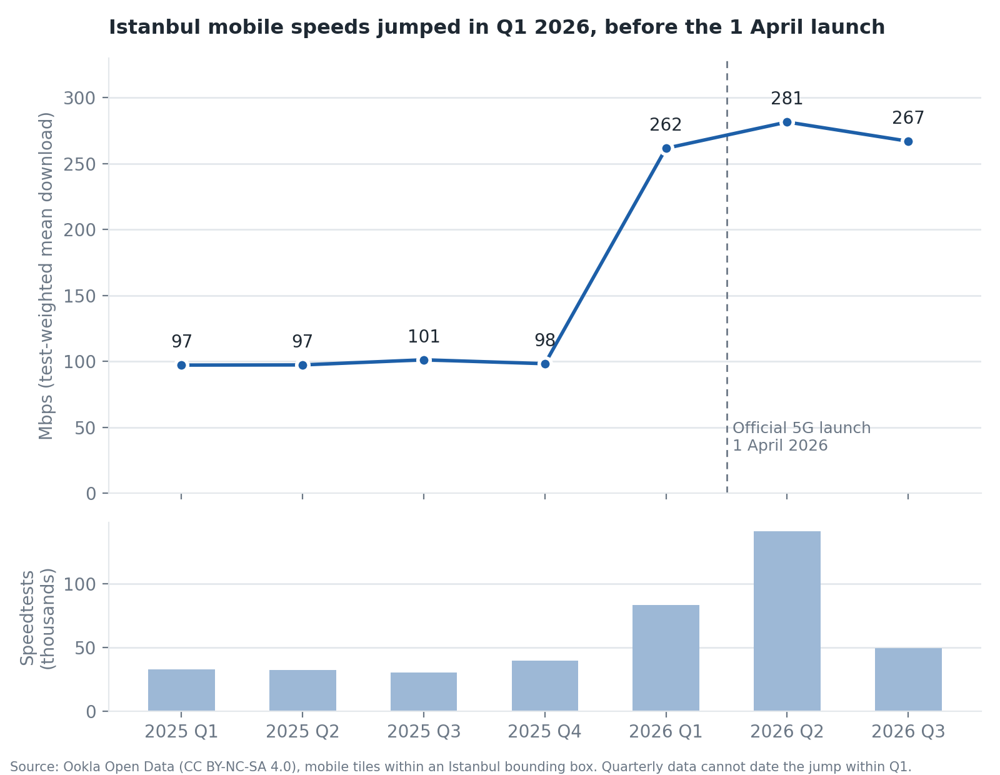
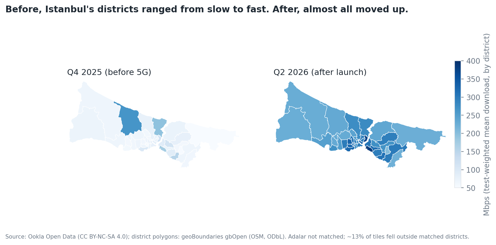

# What did Turkey's 5G launch look like in Istanbul's speed data?

Turkey switched on 5G on 1 April 2026. I wanted to see whether that shows up in public measurements, and where in Istanbul. I used Ookla's open Speedtest data (quarterly, mobile, from 2025 to Q3 2026) and mapped it to Istanbul's districts.

## What I found

- Average mobile download speed in Istanbul sat at about 100 Mbps for all of 2025. In Q1 2026 it jumped to 262 Mbps, then 281 in Q2 and 267 in Q3.
- The jump is already in Q1, before the official launch. Press reports say operators started switching 5G on in the last days of March, so early activation is the likely reason. Quarterly files can't confirm the exact date.
- It looks like 5G, not a general speedup. Tiles above 300 Mbps went from under 1% to 22% in Q1 and 28% in Q2. Latency fell from about 31 ms to 25 ms (Q1) and 23 ms (Q2), and upload rose from about 28 to 37 Mbps. In Q3 latency drifted back up to about 31 ms while download stayed high, so I wouldn't lean on the latency number.
- The median district went from 71 Mbps (Q4 2025) to 283 Mbps (Q2 2026). Slower outer districts gained the most, so the gap between districts shrank.

## Is it real, or a quirk of the data?

I checked a few things.

- **Same places?** Yes. The 4,633 tiles that exist in both Q4 2025 and Q1 2026 went from 68 to 212 Mbps on average, and 81% of them improved. Tiles that only appeared in 2026 held about 6% of Q1 tests and averaged about 258 Mbps, so they aren't driving it.
- **A few devices running many tests?** No. Tests per device stayed around 1.7 to 2.0 in every quarter.
- **A change in Ookla's method?** Unlikely. I ran the same numbers for other cities:

| City | Q4 2025 | Q1 2026 | Q2 2026 |
| --- | --- | --- | --- |
| Istanbul | 98 | 262 | 281 |
| Ankara | 82 | 245 | 259 |
| Izmir | 73 | 171 | 272 |
| Athens | 190 | 201 | 215 |
| Berlin | 170 | 175 | 189 |
| Bucharest | 114 | 135 | 137 |

Only the Turkish cities jump, and Izmir does it in two steps, which looks like a staggered rollout.

- **Just a burst of curious people testing 5G?** Partly, in Q1. Istanbul's test count doubled that quarter (39.6k to 83.4k). If the Q4 tests had stayed at 98 Mbps, the extra 43.8k tests would have averaged about 409 Mbps, which fits early 5G. But by Q3 the test count was back to 49k and the average was still 267 Mbps, so the change lasted.

## What I can't say

- The tiles aren't split by operator, so this says nothing about Vodafone versus Turkcell or Turk Telekom.
- Who runs Speedtest also changed after launch (more 5G phone owners, more curiosity). So I can't tell "the network got faster for everyone" apart from "people with 5G phones tested more". The district map is descriptive only.
- Adalar didn't match a boundary, and about 13% of tiles fell outside the matched districts.
- Some districts have few tests in some quarters (as low as 99), so single-district numbers are noisy.
- Arnavutköy was already very fast in 2025 and then got slower. I didn't find out why.

## Run it yourself

1. `pip install duckdb pandas shapely matplotlib pyarrow`
2. `python3 pull2.py` downloads the Istanbul tiles into `data/` (a few minutes).
3. Get the Turkey district boundaries (ADM2, GeoJSON) from [geoBoundaries](https://www.geoboundaries.org) and save them as `boundaries/tur_adm2.geojson`.
4. Run `02_analysis.py`, `03_charts.py`, `04_sanity_check.py` and `05_investigate.py`.

## Files

- `pull2.py`: downloads the Istanbul tiles
- `02_analysis.py`: assigns tiles to districts, writes `district_results.csv`
- `03_charts.py`: draws the two figures
- `04_sanity_check.py`: compares Istanbul with other cities
- `05_investigate.py`: the checks behind the "is it real" section

## Credits

Speedtest by Ookla Global Fixed and Mobile Network Performance Maps, based on analysis by Ookla of Speedtest Intelligence data (CC BY-NC-SA 4.0, non-commercial use). District boundaries: geoBoundaries (OpenStreetMap contributors, ODbL). Launch timing comes from Turkish tech press reports in late March 2026.
